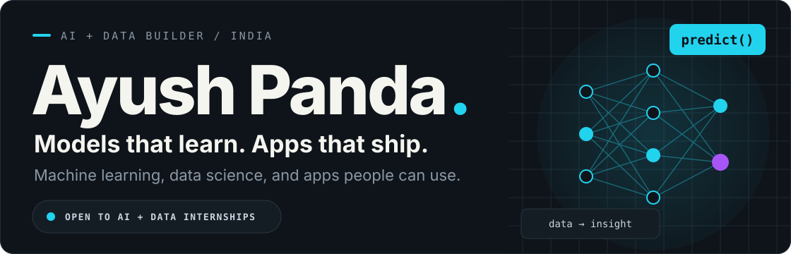
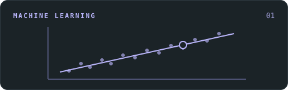
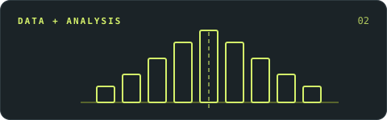
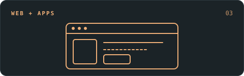

  

I build **[ONE SENTENCE: what you build and why it matters — e.g. Python tools that make data easier to trust and software easier to understand]**. My focus: **[focus area 1]**, **[focus area 2]**, and **[focus area 3]**.

**B.Tech student in Artificial Intelligence at SRM Institute of Science and Technology, Chennai · Open to [internships / jobs / freelance] in [YOUR FIELD]**

## A few things I've built

<table>
<tr>
<td width="50%" valign="top">

### Student Performance Predictor

**What will your daily routine do to your final grade?**

An end-to-end ML app that predicts a final score from study hours, attendance, assignment scores and sleep. Explainable linear regression (R² ≈ 0.87 on held-out data) with a Streamlit interface that labels each result. Built on a synthetic dataset, so no real student data is used.

<code>Python</code> <code>scikit-learn</code> <code>pandas</code> <code>Streamlit</code>

[**Run the app locally ↗**](https://predictstudentperformance.netlify.app/) · [Code](https://github.com/aayushpanda77/student-performance-predictor) · [Notebook](https://github.com/aayushpanda77/student-performance-predictor/blob/main/notebooks/analysis.ipynb)

</td>
<td width="50%" valign="top">

### FinPulse—Smart Loan & Credit Checker

**[One-line hook — e.g. Catch bad data before the pipeline does.]**

[One or two sentences on what it does and who it's for.]

<code>[Tech 1]</code> <code>[Tech 2]</code> <code>[Tech 3]</code> <code>pytest</code>

[**Open the project ↗**](https://finplus-finance.netlify.app/) · [Code](https://github.com/aayushpanda77/PROJECT-TWO-REPO) · [See it run](https://github.com/aayushpanda77/PROJECT-TWO-REPO/actions)

</td>
</tr>
<tr>
<td width="50%" valign="top">

                                                                                                                                                                                                          
**Have an internship, an interesting dataset, or a project to talk about?** [Let's connect.](mailto:aayushpanda77@gmail.com)
