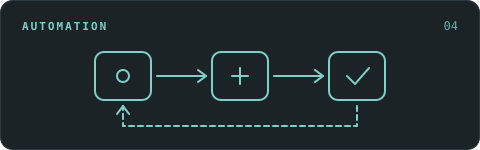
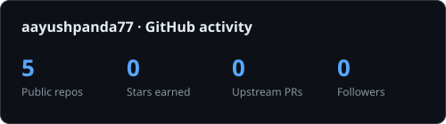

  

I build **[ONE SENTENCE: what you build and why it matters — e.g. Python tools that make data easier to trust and software easier to understand]**. My focus: **[focus area 1]**, **[focus area 2]**, and **[focus area 3]**.

**B.Tech student in Artificial Intelligence at SRM Institute of Science and Technology, Chennai · Open to [internships / jobs / freelance] in [YOUR FIELD]**

## A few things I've built

<table>
<tr>
<td width="50%" valign="top">

### Student Performance Predictor

**What will your daily routine do to your final grade?**

An end-to-end ML app that predicts a final score from study hours, attendance, assignment scores and sleep. Explainable linear regression (R² ≈ 0.87 on held-out data) with a Streamlit interface that labels each result. Built on a synthetic dataset, so no real student data is used.

<code>Python</code> <code>scikit-learn</code> <code>pandas</code> <code>Streamlit</code>

[**Run the app locally ↗**](https://github.com/aayushpanda77/student-performance-predictor#readme) · [Code](https://github.com/aayushpanda77/student-performance-predictor) · [Notebook](https://github.com/aayushpanda77/student-performance-predictor/blob/main/notebooks/analysis.ipynb)

</td>
<td width="50%" valign="top">

### Project Two

**[One-line hook — e.g. Catch bad data before the pipeline does.]**

[One or two sentences on what it does and who it's for.]

<code>[Tech 1]</code> <code>[Tech 2]</code> <code>[Tech 3]</code> <code>pytest</code>

[**Open the project ↗**](https://github.com/aayushpanda77/PROJECT-TWO-REPO#readme) · [Code](https://github.com/aayushpanda77/PROJECT-TWO-REPO) · [See it run](https://github.com/aayushpanda77/PROJECT-TWO-REPO/actions)

</td>
</tr>
<tr>
<td width="50%" valign="top">

### Project Three

**[One-line hook — e.g. Break the code. See why. Test the fix.]**

[One or two sentences on what it does and who it's for.]

<code>[Tech 1]</code> <code>[Tech 2]</code> <code>[Tech 3]</code>

[**Open the app ↗**](https://YOUR-DEMO-LINK.com) · [Code](https://github.com/aayushpanda77/PROJECT-THREE-REPO) · [How it works](https://github.com/aayushpanda77/PROJECT-THREE-REPO#readme)

</td>
<td width="50%" valign="top">

### Project Four

**[One-line hook — e.g. From a reported issue to a recorded fix.]**

[One or two sentences on what it does and who it's for.]

<code>[Tech 1]</code> <code>[Tech 2]</code> <code>[Tech 3]</code>

[**Explore the project ↗**](https://github.com/aayushpanda77/PROJECT-FOUR-REPO#readme) · [Code](https://github.com/aayushpanda77/PROJECT-FOUR-REPO) · [Tests](https://github.com/aayushpanda77/PROJECT-FOUR-REPO/tree/main/tests)

</td>
</tr>
</table>

**Also on my workbench:** [Smaller Project](https://github.com/aayushpanda77/SMALL-PROJECT-REPO) — [one line on what it is].

## Open-source work

I [investigate edge cases, reproduce failures, and submit focused fixes]. These are **submitted upstream pull requests**; each link shows the current review and test status.

| Project | Proposed fix | Evidence |
| --- | --- | --- |
| [Project name] | [What the fix does, one line.] | [Reproduction, checks & review](https://github.com/OWNER/REPO/pull/0000) |
| [Project name] | [What the fix does, one line.] | [Fix, regression tests & CI](https://github.com/OWNER/REPO/pull/0000) |
| [Project name] | [What the fix does, one line.] | [Fix & regression tests](https://github.com/OWNER/REPO/pull/0000) |

[All upstream pull requests](https://github.com/search?q=is%3Apr+author%3Aaayushpanda77+-user%3Aaayushpanda77&type=pullrequests)

## What I work with

| Data & ML | APIs & interfaces | Testing & delivery |
| --- | --- | --- |
| Python · NumPy · pandas | [FastAPI · SQLAlchemy] | [pytest · Ruff] |
| scikit-learn · joblib | [PostgreSQL · SQLite] | Git · GitHub Actions |
| Jupyter · Matplotlib · Seaborn | Streamlit · [React · TypeScript] | [Reproducible experiments] |

## Beyond the notebook

[One or two sentences about something you do outside of programming — a hobby, a creative skill, anything that makes you memorable.]

[See my other work ↗](https://YOUR-OTHER-LINK.com) · [Visit my portfolio ↗](https://ayush-panda.netlify.app/)

<b>A little more: engineering details & GitHub activity</b>

 

Some smaller changes show how I approach the edges of a project:

- [Short description of a notable PR](https://github.com/aayushpanda77/REPO/pull/1), with [what you tested].
- [Short description of a notable commit](https://github.com/aayushpanda77/REPO/commit/HASH).
- [Short description of a notable commit](https://github.com/aayushpanda77/REPO/commit/HASH).

[How this profile is maintained](./docs/profile-maintenance.md)

---

**Have an internship, an interesting dataset, or a project to talk about?** [Let's connect.](mailto:aayushpanda77@gmail.com)
